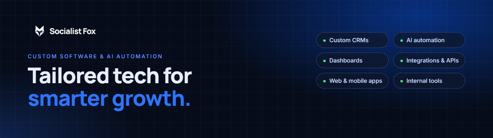

  
  
  

  
  
  
  
  
  

### Hi, we're Socialist Fox 🦊

We design and build custom software, automation and AI systems for growing businesses. Everything is shaped around how your team already works, so the admin shrinks and the work that earns money gets more of your time.

**Your system, your data, fully owned by you.**

### What we build

| | |
|---|---|
| 🧩 **Custom software** | Business platforms, client portals and workflow systems |
| 🤖 **AI and automation** | Email triage, drafted replies, record updates, automated reports |
| 📇 **CRMs and internal tools** | A CRM shaped around your sales process, plus the tools your team uses daily |
| 📊 **Dashboards** | Live KPI dashboards that replace the weekly spreadsheet report |
| 🔌 **Integrations and APIs** | Connect CRM, accounting, payments and email so data moves on its own |
| 📱 **Web and mobile apps** | SaaS platforms, customer apps and tools for field teams |

### Open source

Small, practical tools for sales, marketing and operations teams. Free to use, MIT licensed.

| Project | What it does |
|---|---|
| [**utm-link-builder**](https://github.com/socialistfox/utm-link-builder) | Consistent UTM-tagged campaign links with presets and CSV export · [live demo](https://socialistfox.github.io/utm-link-builder/) |

### How we work

`01 Understand` → `02 Plan` → `03 Build` → `04 Improve`

We map the process with the people who do the work, agree the scope before any code is written, ship working software in short cycles, then keep improving after launch.

Tech we use: TypeScript · React · Next.js · Node.js · Postgres · Supabase · Tailwind CSS · Vercel

---

<b>Need something built?</b> <a href="https://calendly.com/socialistfox">Book a call</a> or visit <a href="https://www.socialistfox.com">socialistfox.com</a>

